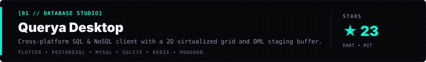
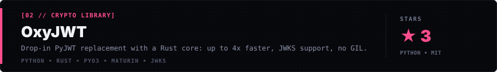
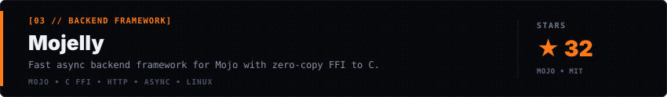
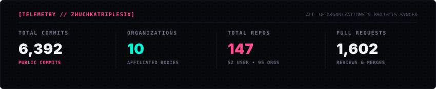

<h3>Vladimir Kozlov · Software Engineer (Python / Rust) · Co-founder @ QueryaHub</h3>

  
  
  

---

> *«Я буду защищать твой код. Любой ценой.»* — Юно Гасай, ревьюер

---

  
  
  
  

  
  
  
  
  
  
  

  
  
  
  

---

### 💗 Проекты

---|---|
| **[Querya Desktop](https://github.com/QueryaHub/Querya-Desktop)** | Лёгкий кроссплатформенный SQL & NoSQL клиент на Flutter |
| **[OxyJWT](https://github.com/QueryaHub/OxyJWT)** | Быстрая JWT-библиотека для Python на Rust, в обход GIL |
| **[OxyRoute](https://github.com/QueryaHub/OxyRoute)** | Python веб-фреймворк с роутингом на Rust |

---

